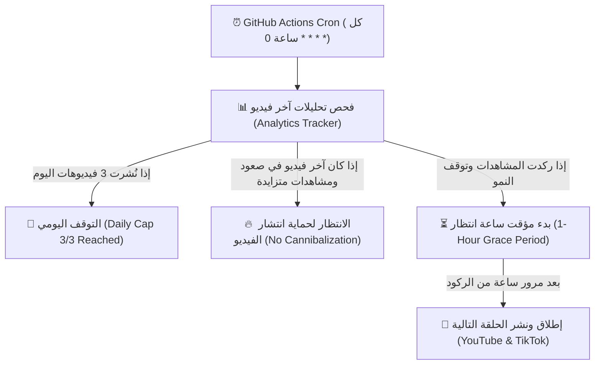

# 🌟 Tales of Wonder (حكايات العجائب) — Master Project Central Hub
> **المرجع المركزي الموحد والشامل لكل ما يتعلق بمشروع أتمتة كارتون يوتيوب للأطفال**
> *Single Source of Truth — تم التجميع والتوحيد النهائي بتاريخ: 25 أكتوبر 2026*

---

## 📍 1. الموقع والمستودع الرسمي (Repository & Location)
* **المسار المحلي (Local Workspace):**
  `C:\Users\SetupGame\.gemini\antigravity\scratch\kids-youtube-automation`
* **المستودع السحابي (GitHub Repository):**
  [https://github.com/achrafbah/kids-youtube-automation](https://github.com/achrafbah/kids-youtube-automation)
* **الفرع الأساسي:** `main`

---

## ⚙️ 2. كيف يعمل النظام الأوتوماتيكي بالكامل (End-to-End Pipeline)

السيستيم مبرمج باش يخدم **بشكل ذكي مبني على تحليلات المشاهدات الحقيقية (Algorithmic Analytics Pacing)** طيلة الـ 24 ساعة عبر **GitHub Actions السحابي**، بدون تجاوز الحد الأقصى **3 فيديوهات في اليوم**:



### القواعد الخوارزمية الذكية (Smart Algorithm Rules):
1. **الحد الأقصى اليومي (Hard Daily Cap):**
   * **ممنوع يفوت 3 فيديوهات فـ اليوم** (`MAX_DAILY_VIDEOS = 3`) للحفاظ على جودة القناة وتفادي الحظر أو تقليل الـ Reach.
2. **متابعة حية لـ Analytics آخر فيديو (`scripts/analytics_tracker.py`):**
   * كود الفحص كيتصل بـ YouTube API وكيجيب عدد المشاهدات الفعلي فـ الوقت الحقيقي.
   * إيلا كان الفيديو الأخير كيحقق صعود ومشاهدات نشطة، السيستيم كيتسنى وما كيلوحش فيديو جديد باش ما "ياكلش" ليه الـ Impressions.
   * فاش كيبان الفيديو الأخير **ركد (Stagnated / Plateaued)**، السيستيم كيبدا مؤقت **ساعة واحدة (1-Hour Grace Period)** للتأكد التام.
   * بعد مرور ديك الساعة، كيعطي الضوء الأخضر المباشر (`GREENLIGHT`) لإنتاج ونشر الحلقة الموالية!
3. **النشر المزدوج المتزامن:**
   * النشر كيمشي لـ **YouTube Shorts** و **TikTok** فـ نفس الوقت.

### المراحل الستة بالتفصيل:

1. **اختيار المحتوى (Curriculum Selection):**
   * كود: `scripts/generate_daily_episode.py` ⬅️ `get_next_unique_curriculum_topic()`
   * كيختار موضوع تربوي جديد من قاعدة البيانات المنهجية (نظافة، أخلاق، نوم، رياضة، طعام صحي، صبر، حروف، أرقام...).
   * **Strict Diversity Guard:** مستحيل حلقة تاخد نفس موضوع أو خلفية الحلقة اللي قبل منها.

2. **الـ Art Director الذكي (Script-to-Visual AI):**
   * كود: `production_studio/art_director.py`
   * كيقرأ السيناريو العربي، وكيحدد:
     * **Palette الألوان:** (Emerald للنشاط، Teal للهدوء، Amber للأكل، Indigo للنوم...).
     * **الجزيئات المتحركة:** (مثلاً: `🕊️ ✨` للصبر، `🍎 🍓` للطعام، `⭐ 🌙` للنوم...).
     * **حركة الكاميرا (Camera Profile 0-4):** تقريب ناعم، ابتعاد، Pan يمين/يسار، أو نبض تنفسي.
     * **المشهد:** كيختار أدق صورة 3D Pixar متطابقة من مكتبة الـ 15 مشهد عالية الدقة.

3. **التعليق الصوتي البيداغوجي (Storytelling TTS):**
   * كود: `scripts/generate_daily_episode.py` ⬅️ `generate_voiceover()`
   * نموذج: `gemini-3.8-flash-tts` بنبرة `Kore` الدافئة المشجعة المخصصة للأطفال.

4. **محرك التحريك والترجمة (Animation Engine):**
   * كود: `production_studio/animation_engine.py`
   * كيرندر فيديو 9:16 Shorts عمودي (1080x1920) فائق الجودة.
   * كيحط الشارة العلوية المتوهجة + الجزيئات العائمة + الترجمة العربية المتزامنة مع الصوت والمشكولة كلياً بالتشكيل التام لتعليم القراءة.

5. **النشر العام في يوتيوب (Direct Public Publishing):**
   * كود: `scripts/youtube_uploader.py`
   * كيرفع الفيديو مباشرة فـ حالة **`Public` (عام)** للقناة.
   * كيعمر الـ Title، الـ Description، والـ Tags، والـ Made for Kids (COPPA).
   * كيرفع الـ Custom Thumbnail عالية الدقة.

6. **التسجيل الذاتي (Auto-Commit History):**
   * سيرفر GitHub كيضيف الحلقة لـ `data/topics_history.json` وكيـ push التحديث للـ repo باش ما تعاودش أبداً.

---

## 📺 3. سجل الحلقات الناجحة المنشورة فعلياً (Live Published Episodes)
هادي روابط الفيديوهات اللي صاوبها ونشرها السيستيم بنجاح فـ يوتيوب:

| الحلقة | الموضوع البيداغوجي | المشهد البصري | الرابط المباشر |
|---|---|---|---|
| 1 | مساعدة الكبار والعطف عليهم 🌟 | ليو يرتب الألعاب ويساعد | [https://youtu.be/EuoZZsvi_zI](https://youtu.be/EuoZZsvi_zI) |
| 2 | الرفق بالحيوان: صديقنا الأليف 🐱 | ليو يطعم القطة الصغيرة فـ الحديقة | [https://youtu.be/VYOt317oU7I](https://youtu.be/VYOt317oU7I) |
| 3 | الصبر الجميل والتحكم في الغضب 🧘‍♂️ | ليو يتنفس بهدوء في حديقة السلام | [https://youtu.be/PjVy7jEtC14](https://youtu.be/PjVy7jEtC14) |

---

## 🔑 4. إعدادات الحساب والمفاتيح السرية (Credentials & Secrets)

### الملفات المحلية (ممنوع نشرها فـ Git، ومحمية بـ `.gitignore`):
* `credentials/client_secret.json`: ملف مصادقة تطبيق Google Cloud / YouTube Data API v3.
* `credentials/token.json`: رمز OAuth2 المجدد تلقائياً للنشر على القناة.
* `.env`: يحتوي على مفتاح `GEMINI_API_KEY`.

### إعدادات السحابة (GitHub Repository Secrets):
مسجلة فـ GitHub تحت: `Settings` ⬅️ `Secrets and variables` ⬅️ `Actions`:
1. `GEMINI_API_KEY`
2. `YOUTUBE_CLIENT_SECRET_JSON`
3. `YOUTUBE_TOKEN_JSON`

---

## 📁 5. خريطة الملفات المنظمة (Project Structure)

```text
kids-youtube-automation/
├── .github/
│   └── workflows/
│       └── daily_automation.yml       # جدولة التشغيل كل ساعتين في السحاب
├── characters/
│   ├── scenes/                        # 15 مشهد 3D Pixar عالي الدقة لجميع المواضيع
│   │   ├── scene_animal_kindness.jpg
│   │   ├── scene_dining_bismillah.jpg
│   │   ├── scene_peace_garden.jpg
│   │   ├── scene_morning_exercise.jpg
│   │   ├── scene_bedtime_stars.jpg
│   │   ├── scene_fruits_kitchen.jpg
│   │   ├── scene_art_colors.jpg
│   │   ├── kids_gentle_bgm.wav        # الموسيقى الهادئة الأصلية للأطفال
│   │   └── ...
│   └── character_bible.json           # ميثاق شخصية ليو ومواصفاته
├── data/
│   └── topics_history.json            # سجل الحلقات وقاعدة البيانات المنهجية
├── production_studio/
│   ├── art_director.py                # محلل السيناريو ومصمم الإضاءة والألوان والكاميرا
│   └── animation_engine.py            # محرك الرندر والتحريك والترجمة المشكولة
├── scripts/
│   ├── generate_daily_episode.py      # السكريبت الرئيسي المشغل للعملية كاملة
│   └── youtube_uploader.py            # رافع الفيديوهات الرسمي لـ YouTube
├── MASTER_PROJECT_CENTRAL.md          # هذا الملف المرجعي المركزي
├── requirements.txt                   # متطلبات بايثون
└── README.md
```

---

## 🚀 6. أوامر التشغيل السريعة (Quick Cheat-Sheet)

### تشغيل حلقة جديدة محلياً فـ أي وقت:
```bash
cd C:\Users\SetupGame\.gemini\antigravity\scratch\kids-youtube-automation
py -3.12 scripts/generate_daily_episode.py
```

### إطلاق التشغيل يدوياً فـ GitHub Actions (Cloud):
1. ادخل للـ Repo فـ المتصفح: [github.com/achrafbah/kids-youtube-automation](https://github.com/achrafbah/kids-youtube-automation)
2. اضغط على تاب **Actions**.
3. اختر **Kids Episode Automation (Tales of Wonder - Every 2 Hours)**.
4. اضغط على زر **Run workflow**.

---

## 🎯 7. القرارات الاستراتيجية الحالية (Strategic Decisions)
1. **التركيز التام على فيديوهات الـ Shorts (9:16):**
   * الفيديوهات القصيرة (20-30 ثانية) هي الأكثر انتشاراً وأعلى جودة في هذا النمط (حركات كاميرا سلسة + نجوم وجزيئات + ترجمة مشكولة كاملة + نشر عام تلقائي).
2. **إيقاف التجارب المعقدة أو الضعيفة:**
   * تم توقيف تجارب الفيديوهات الطويلة (Long-form) للتركيز فقط على ما أثبت نجاحه بجودة ممتازة.
3. **الأتمتة السحابية 100%:**
   * كل ساعتين النظام يقوم بإنتاج ونشر حلقة جديدة تلقائياً بدون الحاجة لأي تدخل منك.
